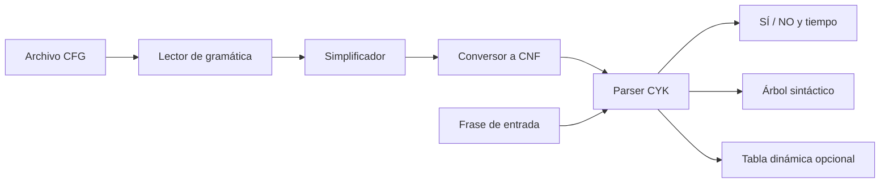

# Informe - Simplificación de gramáticas y algoritmo CYK

**Curso:** Teoría de la Computación  
**Proyecto:** Proyecto 2  
**Autor:** _Completar nombre y carné_  
**Fecha:** _Completar fecha de entrega_

## 1. Descripción

La aplicación determina si una frase pertenece al lenguaje generado por una
gramática libre de contexto. Para poder aplicar CYK, primero simplifica la
gramática y la convierte a Forma Normal de Chomsky (CNF). El reconocimiento se
realiza con programación dinámica y conserva backpointers, lo cual permite
reconstruir un árbol sintáctico cuando la frase es aceptada.

La gramática de inglés entregada en el enunciado ya tiene únicamente reglas de
los tipos `A -> BC` y `A -> a`; por ello ya satisface CNF. Sin embargo, el
programa no depende de esta circunstancia: acepta una CFG general como la
gramática aritmética proporcionada y ejecuta toda la conversión automáticamente.

## 2. Diseño de la aplicación

Se separaron las responsabilidades en cuatro componentes:



### 2.1 Modelo de gramática

`Grammar` almacena el símbolo inicial y un mapa entre cada no terminal y sus
alternativas. Una alternativa es una tupla de símbolos; la tupla vacía
representa epsilon. Se considera no terminal todo símbolo que aparece en algún
lado izquierdo y terminal cualquier otro símbolo.

El lector soporta flechas `->` y `→`, alternativas con `|`, comentarios y
varias formas de escribir epsilon. Las estructuras se vuelven inmutables al
terminar la lectura para evitar cambios accidentales entre etapas.

### 2.2 Simplificación

La simplificación se divide en tres algoritmos independientes:

1. **Eliminación de producciones epsilon.** Se calcula por punto fijo el
   conjunto de símbolos anulables. Para cada producción se generan las
   variantes que omiten cero o más símbolos anulables. Solo se conserva
   `S -> ε` cuando el símbolo inicial realmente deriva epsilon.
2. **Eliminación de producciones unitarias.** Para cada no terminal se calcula
   el cierre transitivo de reglas `A -> B`. Después se copian las reglas no
   unitarias alcanzables y se eliminan las unitarias.
3. **Eliminación de símbolos inútiles.** Primero se calculan los símbolos que
   pueden generar cadenas de terminales y después los que son alcanzables desde
   el símbolo inicial. Todo símbolo que no cumpla ambas propiedades se elimina.

Estas etapas están disponibles por separado para poder probarlas, y también se
agrupan en la función `simplify`.

### 2.3 Conversión a CNF

Después de simplificar se aplican dos transformaciones:

- Un terminal que aparece dentro de una regla de longitud mayor que uno se
  sustituye por un no terminal auxiliar. Por ejemplo, `A -> a B` se transforma
  en `A -> _T B` y `_T -> a`.
- Una regla con más de dos símbolos se binariza. Por ejemplo,
  `A -> B C D` se transforma en `A -> B _B` y `_B -> C D`.

Al final se valida programáticamente que cada regla sea `A -> BC`, `A -> a` o,
en el caso especial permitido, `S -> ε`.

### 2.4 Algoritmo CYK

Para una entrada de `n` tokens se crea una tabla triangular. La celda
`tabla[i,j]` contiene todos los no terminales capaces de producir el fragmento
desde el token `i` hasta el token `j`.

Pseudocódigo:

```text
para i = 1 hasta n:
    para cada regla A -> token[i]:
        agregar A a tabla[i,i]

para longitud = 2 hasta n:
    para cada inicio posible i:
        j = i + longitud - 1
        para corte k = i hasta j - 1:
            para B en tabla[i,k]:
                para C en tabla[k+1,j]:
                    para cada regla A -> B C:
                        agregar A a tabla[i,j]

aceptar si el símbolo inicial está en tabla[1,n]
```

Las reglas terminales y binarias se indexan previamente. Así se busca
directamente qué lados izquierdos corresponden a un terminal o al par `(B,C)`,
sin recorrer todas las producciones en cada celda.

La complejidad temporal clásica es `O(n³ · |P|)` y el espacio es `O(n² · |V|)`,
donde `P` es el conjunto de producciones y `V` el conjunto de no terminales.
Los índices reducen el trabajo práctico, aunque no cambian el límite cúbico con
respecto a la longitud de la entrada.

### 2.5 Reconstrucción del árbol

En lugar de guardar solamente un booleano, cada entrada de la tabla conserva:

- el no terminal reconocido;
- el punto de corte usado;
- los dos nodos hijos, o el terminal correspondiente en la diagonal.

Si el símbolo inicial aparece en la celda superior, esos backpointers se
recorren recursivamente. El programa imprime una vista gráfica y otra
parentizada. Si hay ambigüedad, se muestra el primer árbol encontrado de manera
determinista; la pertenencia al lenguaje no cambia.

### 2.6 Medición del tiempo

La medición usa un reloj de alta resolución y abarca únicamente la construcción
y llenado de la tabla CYK. La lectura y conversión de la gramática, la
tokenización y la impresión se excluyen para que el dato corresponda al
algoritmo solicitado. Se reportan milisegundos y nanosegundos. El valor cambia
entre ejecuciones según el equipo y la carga del sistema.

## 3. Ejemplos y pruebas realizadas

### 3.1 Frases que pertenecen al lenguaje

| Frase | Resultado esperado | Estructura principal |
|---|---:|---|
| `She eats a cake with a fork.` | SÍ | `S -> NP VP`, `VP -> VP PP` |
| `The cat drinks the beer.` | SÍ | `S -> NP VP`, `VP -> V NP` |
| `He cooks.` | SÍ | `S -> NP VP` |
| `A dog eats the soup in the oven.` | SÍ | `VP -> VP PP` |

La aceptación de frases extrañas en significado, como `A dog eats the soup in
the oven`, es correcta para este proyecto: la gramática valida sintaxis, no
semántica.

### 3.2 Frases que no pertenecen al lenguaje

| Frase | Resultado esperado | Motivo |
|---|---:|---|
| `Cake she eats a.` | NO | Orden sintáctico inválido |
| `She likes cake.` | NO | `likes` no está en el vocabulario |
| `The cat the beer drinks.` | NO | No existe una derivación con ese orden |
| `She eats with.` | NO | La preposición necesita un `NP` |

### 3.3 Ejemplo de ejecución

```text
> python main.py "The cat drinks the beer"

Frase normalizada: the cat drinks the beer
Resultado: SÍ
Tiempo CYK: 0.xxxxxx ms (... ns)

Arbol sintactico:
S
├── NP
│   ├── Det
│   │   └── the
│   └── N
│       └── cat
└── VP
    ├── V
    │   └── drinks
    └── NP
        ├── Det
        │   └── the
        └── N
            └── beer
```

### 3.4 Pruebas automatizadas

Se incluyeron 12 pruebas que cubren:

- aceptación de los dos ejemplos del enunciado;
- aceptación con pronombre y verbo sin objeto;
- rechazo por orden incorrecto y palabra desconocida;
- reconstrucción de los terminales del árbol;
- eliminación de epsilon, reglas unitarias y símbolos inútiles;
- validación de CNF;
- conversión y análisis de la gramática aritmética compartida;
- rechazo de una expresión aritmética incompleta.

Comando de ejecución:

```powershell
python -m unittest discover -s tests -v
```

Resultado obtenido: `Ran 12 tests ... OK`.

## 4. Discusión

### Obstáculos encontrados

1. **Diferenciar terminales y no terminales.** Se resolvió con la convención
   estándar de considerar no terminal todo símbolo definido a la izquierda.
   Esto evita depender de mayúsculas y permite nombres como `Det`.
2. **No confundir `e` con el no terminal `E`.** La gramática aritmética usa `e`
   para epsilon y `E` para expresión. El lector distingue mayúsculas al
   reconocer el marcador corto.
3. **Preservar el árbol.** Un CYK booleano solo responde pertenencia. Fue
   necesario almacenar nodos completos en las celdas y ocultar, al presentar el
   resultado, los auxiliares introducidos durante la conversión.
4. **Gramáticas ambiguas.** Una celda podría tener varias derivaciones para el
   mismo no terminal. Como el requisito pide construir un árbol y no enumerar
   todos, se conserva el primero según un orden estable.
5. **Puntuación y mayúsculas.** Las palabras se comparan sin distinguir
   mayúsculas y se permite puntuación final `.`, `?` o `!`. Otros símbolos no
   reconocidos permanecen como tokens y provocan un `NO`, en vez de ser
   eliminados silenciosamente.

### Recomendaciones

- Escribir espacios entre símbolos en los archivos de gramática.
- Ejecutar las pruebas después de modificar reglas o algoritmos.
- Usar `--show-cnf` para revisar la transformación y `--show-table` para fines
  didácticos.
- Repetir varias veces una prueba si se desea comparar rendimiento, pues las
  frases pequeñas producen tiempos muy cortos y variables.
- No interpretar la aceptación como validez semántica; CYK solo comprueba lo que
  la gramática especifica.

## 5. Conclusión

La solución satisface los tres resultados solicitados: indica pertenencia con
`SÍ` o `NO`, mide el tiempo del reconocimiento y construye el árbol sintáctico.
Además, implementa explícitamente los algoritmos de simplificación y conversión
a CNF, por lo que no se limita a la gramática de ejemplo ya normalizada.

## 6. Referencias

- Hopcroft, J. E., Motwani, R. y Ullman, J. D. *Introduction to Automata Theory,
  Languages, and Computation*, 3.ª edición, Pearson, 2006.
- Cocke, J.; Younger, D. H.; Kasami, T. Trabajos clásicos que dieron origen al
  algoritmo de reconocimiento conocido como CYK.
- Cormen, T. H. et al. *Introduction to Algorithms*, secciones de programación
  dinámica, MIT Press.
